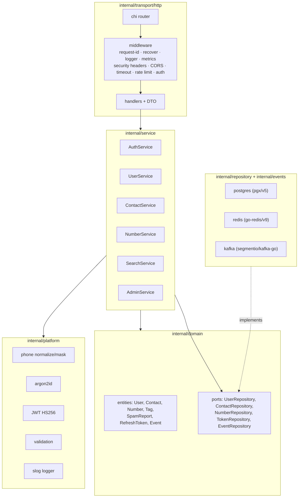
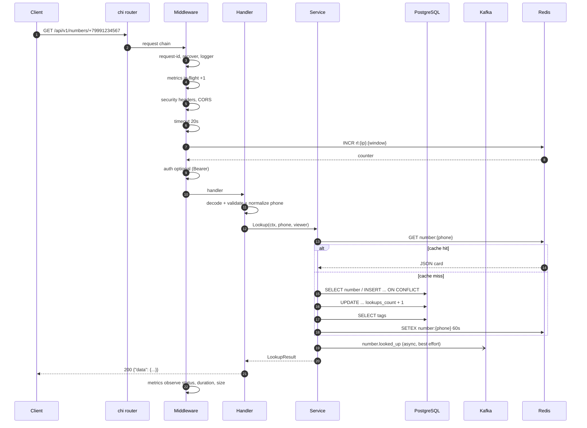
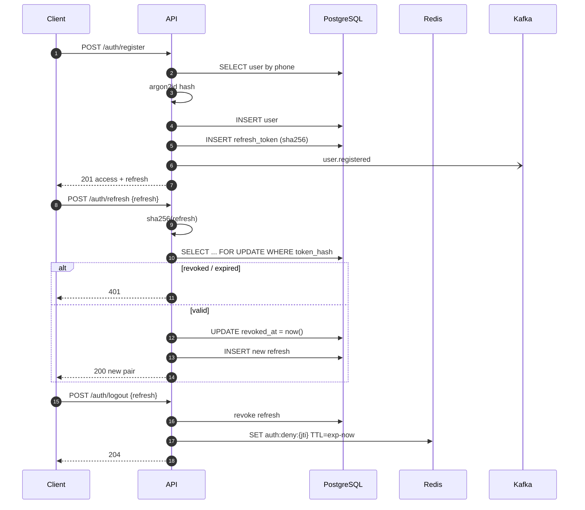
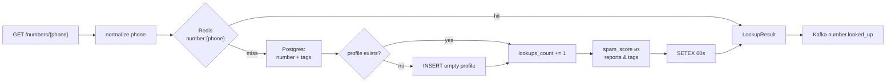
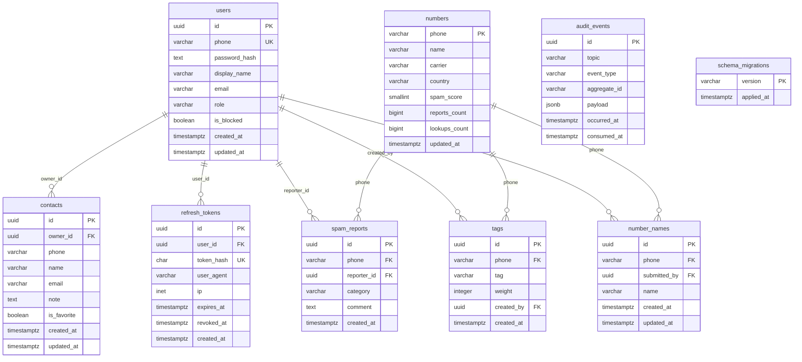
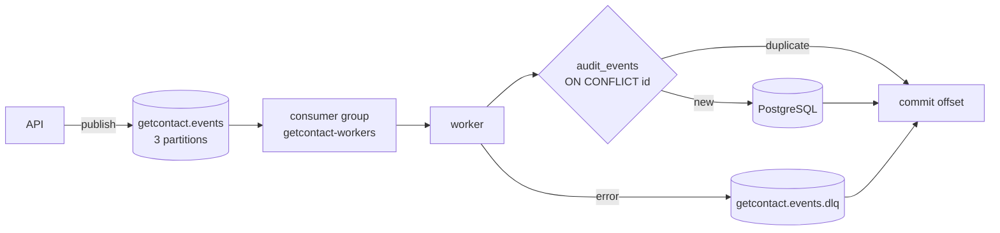

# Архитектура GetContact API

> Документ описывает слои, поток запроса, модель данных, кэширование, события и
> принятые компромиссы. Диаграммы отрисовываются GitHub/Mermaid.

---

## 1. Цели и ограничения

| Цель | Как достигнута |
|---|---|
| Быстрый caller-ID lookup | Redis-кэш 60 с + индексы PostgreSQL + один запрос на карточку |
| Защита от накрутки рейтинга | Один активный спам-репорт на пару (номер, пользователь), уникальный индекс |
| Горизонтальное масштабирование API | Stateless-процесс, общее состояние в Postgres/Redis/Kafka |
| Надёжная доставка событий | Kafka + consumer group + идемпотентный `audit_events` + DLQ |
| Безопасность | argon2id, короткоживущий JWT, ротация refresh, Redis blacklist, rate limit |
| Наблюдаемость | Prometheus-метрики на каждом слое, готовый Grafana-дашборд и алерты |

Ограничения демо-стенда: один брокер Kafka (RF=1), один инстанс Postgres/Redis,
StatefulSet'ы в Kubernetes — baseline, а не HA-топология.

---

## 2. Слои



**Правило зависимостей:** `transport → service → domain`, адаптеры реализуют
интерфейсы домена. Домен не импортирует ни HTTP, ни SQL, ни Kafka.

### Пакеты

| Пакет | Ответственность |
|---|---|
| `cmd/api` | composition root API: конфиг, пулы, сервисы, HTTP-сервер, graceful shutdown |
| `cmd/worker` | composition root worker: consumer group, метрики, readiness |
| `internal/transport/http` | маршруты, middleware, декодирование, коды ошибок, Swagger |
| `internal/service` | бизнес-правила, проверка прав, транзакционные сценарии |
| `internal/domain` | сущности, инварианты, sentinel-ошибки, порты |
| `internal/repository/postgres` | SQL, pgx.Batch, миграции под advisory lock |
| `internal/repository/redis` | кэш, fixed-window rate limit, JWT denylist |
| `internal/events` | конверт события, producer, consumer, DLQ |
| `internal/metrics` | Prometheus-коллекторы |
| `internal/apperr` | доменная ошибка → HTTP-статус/код |
| `internal/platform` | телефон, пароли, JWT, валидация, логгер |

---

## 3. Жизненный цикл HTTP-запроса



Особенности:

- **Request ID** принимается из `X-Request-Id` (если валиден) или генерируется;
  возвращается в заголовке и в теле ошибки.
- **Таймаут** задаётся `HTTP_REQUEST_TIMEOUT`; обработчик получает `context.WithTimeout`.
- **Panic** перехватывается, логируется со стеком, клиент получает `500 INTERNAL_ERROR`.
- **Метрики** считаются по route-шаблону (`/api/v1/numbers/{phone}`), а не по сырому URL,
  поэтому кардинальность ограничена.
- **Rate limit** — Redis fixed window. Ключ включает IP и bucket (`auth`/`public`).
  При ошибке Redis лимитер пропускает запрос (fail-open) и инкрементирует метрику ошибки.
- **Аутентификация**: публичные маршруты не требуют токен, но `RequireAuth`/`RequireAdmin`
  стоят на защищённых. Для lookup токен опционален.

### Маппинг ошибок

| Домен | HTTP | Код |
|---|---|---|
| ошибка валидации | 422 | `VALIDATION_ERROR` |
| `ErrUnauthorized`, `ErrInvalidToken` | 401 | `UNAUTHORIZED` |
| `ErrForbidden` | 403 | `FORBIDDEN` |
| `ErrBlocked` | 403 | `USER_BLOCKED` |
| `ErrNotFound` | 404 | `NOT_FOUND` |
| `ErrConflict` | 409 | `CONFLICT` |
| rate limiter | 429 | `RATE_LIMITED` |
| таймаут | 504 | `REQUEST_TIMEOUT` |
| прочее | 500 | `INTERNAL_ERROR` |

Формат ошибки:

```json
{
  "error": {
    "code": "VALIDATION_ERROR",
    "message": "request validation failed",
    "details": { "phone": "must be a valid phone number (8..15 digits)" },
    "request_id": "4a8f2c1e9b7d"
  }
}
```

---

## 4. Аутентификация и сессии



Детали:

- **Пароль**: argon2id, параметры по умолчанию 64 MiB / 3 итерации / 2 потока,
  PHC-строка `$argon2id$v=19$m=65536,t=3,p=2$...`. Проверка — constant-time.
- **Access JWT**: HS256, claims `sub`, `role`, `iss`, `iat`, `exp`, `jti`.
  TTL 15 минут. При каждом запросе проверяется подпись, срок и Redis denylist.
- **Refresh**: 32 случайных байта (base64url), в БД только SHA-256. Одноразовый:
  при ротации старый помечается `revoked_at`, повторное использование → 401.
- **Logout**: access JTI попадает в Redis с TTL до истечения токена; refresh отзывается.
- **Блокировка**: `SetBlocked` + `RevokeAllForUser`; middleware отклоняет заблокированных
  с `403 USER_BLOCKED`, логин тоже возвращает 403.
- **Смена пароля**: проверяет текущий пароль, обновляет хэш и отзывает все refresh.

### Rate limiting

| Bucket | Маршруты | Лимит по умолчанию |
|---|---|---|
| `auth` | `/auth/register`, `/auth/login`, `/auth/refresh` | 20/мин на IP |
| `public` | остальные, включая lookup | 120/мин на IP |

Окно — `RATE_LIMIT_WINDOW` (1 минута). Заголовки ответа:
`X-RateLimit-Limit`, `X-RateLimit-Remaining`, `Retry-After` при 429.

---

## 5. Caller-ID и spam score



**Формула spam score** (детерминированная, пересчитывается в SQL):

```text
tagPart   = min(40, SUM(weight) FILTER (tag IN risky_tags) * 3)
score     = min(100, reports_count * 12 + tagPart)
```

Risky-теги: `fraud`, `scam`, `spam`, `telemarketing`, `robocall`, `мошенник`, `спам`.
Вес тега растёт при повторном добавлении того же тега (upsert по `(phone, tag)`).

**Нормализация телефона.** `platform.NormalizePhone` принимает `+`, `00`,
локальные `8…`/10-значные номера, скобки, пробелы, Unicode-дефисы и full-width
цифры. Явный `+`/`00` отключает российские эвристики, поэтому международные
номера не переписываются; на выходе всегда `+<8..15 цифр>`. BOM и zero-width
символы вырезаются, ввод длиннее 64 байт отклоняется.

**Community-имена.** `number_names` хранит по одному голосу на пользователя и
номер; повторная отправка заменяет вариант, а `numbers.name` пересчитывается по
самому популярному имени.

**Инвалидация кэша:** после добавления/удаления тега, имени и после
спам-репорта ключ `number:{phone}` удаляется, чтобы следующий lookup увидел
новый score.

**Идемпотентность репорта** обеспечивает уникальный индекс `(phone, reporter_id)`;
повторная попытка возвращает `409 CONFLICT`, а не увеличивает счётчик.

---

## 6. Модель данных



> `numbers.phone` — нормализованный E.164 (`+79991234567`). Таблица не имеет FK на
> `users`: caller-ID профиль существует для любого номера, даже если владелец не
> зарегистрирован.

### Индексы

| Таблица | Индекс | Зачем |
|---|---|---|
| `users` | `UNIQUE(phone)` | логин, регистрация |
| `users` | `UNIQUE(lower(email)) WHERE email <> ''` | защита от дублей email |
| `users` | `(created_at DESC)` | админ-список |
| `users` | `(is_blocked) WHERE is_blocked` | счётчик блокировок |
| `users` | GIN `display_name gin_trgm_ops` | поиск по имени |
| `contacts` | `(owner_id, created_at DESC)` | список книги |
| `contacts` | `(owner_id, lower(name))` | сортировка/поиск |
| `contacts` | `(owner_id) WHERE is_favorite` | избранное |
| `contacts` | GIN `name gin_trgm_ops` | `ILIKE %q%` |
| `contacts` | `UNIQUE(owner_id, phone)` | upsert импорта |
| `numbers` | `(spam_score DESC, reports_count DESC)` | топ спама |
| `numbers` | `(lookups_count DESC)` | популярные номера |
| `numbers` | GIN `name gin_trgm_ops` | поиск |
| `tags` | `UNIQUE(phone, tag)` | upsert веса |
| `tags` | `(phone, weight DESC)` | теги карточки |
| `tags` | `(tag)` | каталог тегов |
| `tags` | `(created_by) WHERE created_by IS NOT NULL` | права на удаление |
| `spam_reports` | `UNIQUE(phone, reporter_id)` | анти-накрутка |
| `spam_reports` | `(phone, created_at DESC)` | история номера |
| `spam_reports` | `(created_at DESC)` | админ-очередь |
| `number_names` | `UNIQUE(phone, submitted_by) WHERE submitted_by IS NOT NULL` | один голос на пользователя |
| `number_names` | `(phone, created_at DESC)` | голоса номера |
| `number_names` | `(phone, name)` | агрегация вариантов |
| `refresh_tokens` | `UNIQUE(token_hash)` | ротация |
| `refresh_tokens` | `(user_id) WHERE revoked_at IS NULL` | отзыв сессий |
| `refresh_tokens` | `(expires_at) WHERE revoked_at IS NULL` | очистка |
| `audit_events` | `(event_type, consumed_at DESC)` | аудит |
| `audit_events` | `(aggregate_id)` | история агрегата |

Расширение `pg_trgm` включено миграцией; GIN-индексы ускоряют `ILIKE '%...%'`.

### Триггеры

- `set_updated_at()` — обновляет `updated_at` на `users`, `contacts`, `numbers`.
- Счётчики `reports_count`/`lookups_count` меняются атомарными `UPDATE ... + 1`,
  без read-modify-write.

### Миграции

`internal/repository/postgres/migrate.go` встраивает `migrations/*.sql` через `embed`,
берёт `pg_advisory_lock`, применяет отсутствующие версии по порядку, пишет
`schema_migrations`. Это безопасно при одновременном старте N реплик API.

---

## 7. Контакты и импорт

- Список поддерживает `q` (по имени/номеру), `favorite`, `page`, `per_page` (1..100).
- Поиск использует `ILIKE` + trigram-индекс; сортировка — избранные, затем `created_at DESC`.
- **Bulk import** принимает 1..500 контактов, нормализует телефоны, дедуплицирует
  вход по номеру и выполняет `pgx.Batch` с `INSERT ... ON CONFLICT (owner_id, phone)
  DO UPDATE`. Возвращает `imported`/`skipped`.
- Все операции с контактами фильтруются по `owner_id` из JWT — IDOR невозможен.

---

## 8. Поиск

`GET /api/v1/search?q=...&limit=N` объединяет:

1. Общий справочник номеров (`numbers.name ILIKE`, trigram).
2. Личную книгу текущего пользователя (`contacts.name/phone`).

Результат: `{query, numbers[], contacts[]}`. Лимит применяется к каждой коллекции.

---

## 9. Kafka и worker



- Публикация **best effort**: ошибка Kafka не ломает HTTP-ответ, но инкрементирует
  `getcontact_kafka_events_total{result="error"}`.
- Consumer читает батчами, коммитит offset только после обработки.
- Идемпотентность: `INSERT INTO audit_events (id, ...) ON CONFLICT (id) DO NOTHING`;
  если строка уже есть — событие считается обработанным.
- Ошибка обработки → сообщение уходит в DLQ, offset коммитится, метрика ошибки растёт.
- Контракты и payload'ы — в [EVENTS.md](EVENTS.md).

---

## 10. Кэш, лимиты и отказоустойчивость

| Механизм | Ключ | TTL | Поведение при сбое |
|---|---|---|---|
| Caller-ID кэш | `number:{phone}` | 60 с | идём в Postgres |
| Rate limit | `rl:{bucket}:{ip}:{window}` | окно | fail-open |
| JWT denylist | `auth:deny:{jti}` | до `exp` | запрос отклоняется (fail-closed) |
| Readiness | — | — | 503, если Postgres/Redis/Kafka недоступны |

Почему denylist fail-closed: при недоступном Redis нельзя гарантировать, что
отозванный токен не используется; безопаснее вернуть 401, чем пропустить.

Почему rate limit fail-open: иначе падение кэша превращает API в полностью
недоступный сервис. Это осознанный компромисс для demo/production baseline.

**Graceful shutdown**: API перестаёт принимать соединения, ждёт до
`HTTP_SHUTDOWN_TIMEOUT`, закрывает pgx pool, Redis и Kafka writer. Worker
останавливает consumer и коммитит обработанные offset'ы.

---

## 11. Безопасность

- Пароли — argon2id; в JSON никогда не отдаётся `password_hash`.
- Телефон другого пользователя в публичном профиле маскируется (`*******4567`).
- SQL — только параметризованные запросы pgx.
- Валидация телефона: 8..15 цифр, нормализация в E.164, запрет ведущего нуля.
- Теги: 2..32 символа, whitelist символов, нормализация в нижний регистр.
- Security headers: `X-Content-Type-Options`, `X-Frame-Options`,
  `Referrer-Policy`, `Content-Security-Policy` для Swagger UI.
- CORS настраивается через env; wildcard допустим только в dev.
- JWT secret в production обязан быть ≥ 32 символов (проверка в `config.Load`).
- Контейнеры: non-root, read-only rootfs, drop ALL capabilities,
  `allowPrivilegeEscalation: false`.
- NetworkPolicy в Kubernetes ограничивает east-west трафик.

---

## 12. Компромиссы и что дальше

| Решение | Плюс | Минус / следующий шаг |
|---|---|---|
| Fixed-window rate limit | простой, атомарный `INCR` | всплеск на границе окна → sliding window/token bucket |
| Кэш карточки целиком | 1 round-trip | инвалидация по тегу/репорту; при массовых изменениях — версионирование |
| Spam score в SQL | консистентность | тяжёлые агрегаты на больших объёмах → materialized view/worker |
| Refresh в Postgres | аудит и отзыв | растёт таблица → periodic cleanup job |
| Best-effort Kafka | API не зависит от брокера | возможна потеря события → outbox pattern |
| Один Kafka-брокер в demo | простота | production: 3+ брокера, RF=3, min.insync.replicas=2 |
| StatefulSet для БД в k8s | самодостаточный стенд | production: managed Postgres/Redis/Kafka или операторы |

Направления развития: outbox + Debezium, OpenTelemetry-трейсинг, кэш тегов,
гео-справочник операторов, верификация номеров через SMS, экспорт метрик в
VictoriaMetrics, e2e-тесты в CI с testcontainers.
