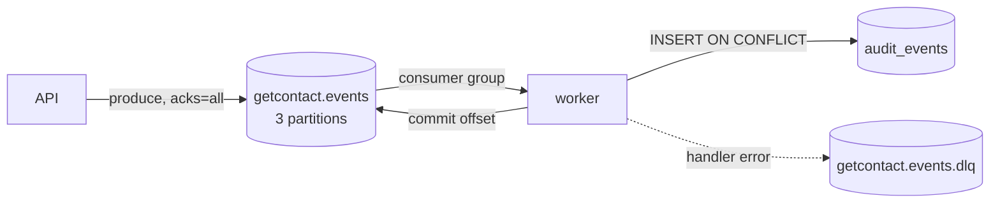

# Kafka Events

API публикует доменные события в топик `getcontact.events`, worker читает их
consumer group'ой `getcontact-workers`, пишет идемпотентный аудит и пересчитывает
производные данные. Ошибки уходят в `getcontact.events.dlq`.



---

## 1. Конфигурация

| Переменная | По умолчанию | Смысл |
|---|---|---|
| `KAFKA_ENABLED` | `true` | выключает producer/consumer (полезно для unit/dev) |
| `KAFKA_BROKERS` | `localhost:9092` | список через запятую |
| `KAFKA_TOPIC` | `getcontact.events` | основной топик |
| `KAFKA_DLQ_TOPIC` | `getcontact.events.dlq` | dead-letter topic |
| `KAFKA_GROUP_ID` | `getcontact-workers` | consumer group worker'а |

Топики создаются `kafka-init` (Compose и Kubernetes Job):

```bash
kafka-topics.sh --bootstrap-server kafka:9092 \
  --create --if-not-exists --topic getcontact.events \
  --partitions 3 --replication-factor 1

kafka-topics.sh --bootstrap-server kafka:9092 \
  --create --if-not-exists --topic getcontact.events.dlq \
  --partitions 1 --replication-factor 1
```

Для production: `--replication-factor 3`, `min.insync.replicas=2`,
`unclean.leader.election=false`, 6+ партиций.

---

## 2. Конверт события

```json
{
  "id": "9f1c2c4e-7a1b-4c2d-8e3f-0a1b2c3d4e5f",
  "type": "number.spam_reported",
  "version": 1,
  "occurred_at": "2026-01-01T10:00:00.123456Z",
  "aggregate_id": "+79995555555",
  "payload": { }
}
```

| Поле | Тип | Описание |
|---|---|---|
| `id` | UUID | уникальный ID события; ключ идемпотентности |
| `type` | string | тип из таблицы ниже |
| `version` | int | версия схемы, сейчас `1` |
| `occurred_at` | RFC3339 UTC | время факта |
| `aggregate_id` | string | ID агрегата: user/contact UUID или телефон |
| `payload` | object | данные события |

**Kafka key** — `aggregate_id`, поэтому события одного агрегата попадают в одну
партицию и обрабатываются по порядку в рамках партиции.

**Headers** (producer):

| Header | Значение |
|---|---|
| `event_id` | UUID события |
| `event_type` | тип |
| `content-type` | `application/json` |

---

## 3. Типы событий

### `user.registered`

Публикуется после успешной регистрации. `aggregate_id` = user UUID.

```json
{
  "user_id": "0c3f7f1e-2f4e-4c1e-9a51-2f9b7c1d8e44",
  "phone": "+79991234567",
  "display_name": "Ivan Petrov"
}
```

### `user.blocked`

Публикуется при изменении флага блокировки администратором.
`aggregate_id` = user UUID.

```json
{
  "user_id": "0c3f7f1e-2f4e-4c1e-9a51-2f9b7c1d8e44",
  "blocked": true,
  "actor_id": "e1a2b3c4-d5e6-4f70-8a9b-0c1d2e3f4a5b"
}
```

### `user.logged_in`

Публикуется после успешного входа. `aggregate_id` = user UUID. Содержит только
контекст, который клиент явно передал, плюс IP и User-Agent запроса; никаких
контактов, фото, файлов или сообщений.

```json
{
  "user_id": "0c3f7f1e-2f4e-4c1e-9a51-2f9b7c1d8e44",
  "session_id": "3f6b1c2a-7d4e-4a9b-8c1d-2e3f4a5b6c7d",
  "ip": "203.0.113.7",
  "user_agent": "GetContact/1.2.3 (Android 15; Pixel 9 Pro)",
  "device_id": "8f3c2a7e-1b2d-4c5e-9f00-1234567890ab",
  "device_name": "Pixel 9 Pro",
  "device_model": "Pixel 9 Pro",
  "manufacturer": "Google",
  "os": "Android",
  "os_version": "15",
  "app_version": "1.2.3",
  "client": "android"
}
```

### `user.session_revoked`

Публикуется, когда пользователь завершает одну из своих сессий.
`aggregate_id` = user UUID.

```json
{
  "user_id": "0c3f7f1e-2f4e-4c1e-9a51-2f9b7c1d8e44",
  "session_id": "3f6b1c2a-7d4e-4a9b-8c1d-2e3f4a5b6c7d",
  "actor_id": "0c3f7f1e-2f4e-4c1e-9a51-2f9b7c1d8e44"
}
```

### `contact.created`

Публикуется после создания контакта и после bulk-import (на каждый контакт).
`aggregate_id` = contact UUID.

```json
{
  "contact_id": "5b2c3d4e-6f70-4819-a2b3-c4d5e6f70819",
  "owner_id": "0c3f7f1e-2f4e-4c1e-9a51-2f9b7c1d8e44",
  "phone": "+79997654321",
  "name": "Alice Johnson"
}
```

> Событие не содержит `email`/`note` — только нечувствительные поля.

### `number.looked_up`

Публикуется на caller-ID lookup. `aggregate_id` = нормализованный телефон.

```json
{
  "phone": "+79991234567",
  "user_id": "0c3f7f1e-2f4e-4c1e-9a51-2f9b7c1d8e44",
  "result": "cache_miss"
}
```

`user_id` отсутствует для анонимного lookup. `result`: `cache_hit` | `cache_miss`.
Событие high-volume: при необходимости семплируйте его на стороне API.

### `number.tag_added`

Публикуется после добавления/усиления тега. `aggregate_id` = телефон.

```json
{
  "phone": "+79991234567",
  "tag": "telemarketing",
  "weight": 4,
  "user_id": "0c3f7f1e-2f4e-4c1e-9a51-2f9b7c1d8e44"
}
```

### `number.spam_reported`

Публикуется после принятого спам-репорта. `aggregate_id` = телефон.

```json
{
  "report_id": "7d8e9f00-1a2b-4c3d-9e4f-5a6b7c8d9e0f",
  "phone": "+79995555555",
  "category": "telemarketing",
  "reporter_id": "0c3f7f1e-2f4e-4c1e-9a51-2f9b7c1d8e44"
}
```

### `number.name_added` / `number.name_removed`

Голос за community-имя. `aggregate_id` = телефон. Добавление и смена варианта
публикуют `number.name_added`, удаление — `number.name_removed`.

```json
{
  "name_id": "b1c2d3e4-f5a6-4b7c-8d9e-0f1a2b3c4d5e",
  "phone": "+79991234567",
  "name": "Иван Петров",
  "user_id": "0c3f7f1e-2f4e-4c1e-9a51-2f9b7c1d8e44"
}
```

### `number.spam_deleted`

Администратор удалил репорт; worker пересчитывает агрегаты. `aggregate_id` = телефон.

```json
{
  "report_id": "7d8e9f00-1a2b-4c3d-9e4f-5a6b7c8d9e0f",
  "phone": "+79995555555",
  "actor_id": "0c3f7f1e-2f4e-4c1e-9a51-2f9b7c1d8e44"
}
```

### `admin.number_viewed`

Пишется при **каждом** успешном чтении админского досье. Это ключевое событие
подотчётности: по нему видно, кто и когда смотрел полный профиль номера.

```json
{
  "phone": "+79991234567",
  "actor_id": "0c3f7f1e-2f4e-4c1e-9a51-2f9b7c1d8e44"
}
```

### `admin.number_updated`

Администратор изменил `name`, `carrier` или `country` профиля номера.

```json
{
  "phone": "+79991234567",
  "actor_id": "0c3f7f1e-2f4e-4c1e-9a51-2f9b7c1d8e44",
  "name": "Иван Петров",
  "carrier": "MTS",
  "country": "RU"
}
```

### Сводка

| Тип | Aggregate | Когда |
|---|---|---|
| `user.registered` | user UUID | регистрация |
| `user.logged_in` | user UUID | успешный вход (IP/устройство) |
| `user.session_revoked` | user UUID | завершение сессии |
| `user.blocked` | user UUID | block/unblock |
| `contact.created` | contact UUID | create/import |
| `number.looked_up` | phone | каждый lookup |
| `number.tag_added` | phone | add/upsert tag |
| `number.name_added` | phone | add/change name vote |
| `number.name_removed` | phone | delete name vote |
| `number.spam_reported` | phone | accepted report |
| `number.spam_deleted` | phone | admin deletes report |
| `admin.number_viewed` | phone | admin reads dossier |
| `admin.number_updated` | phone | admin edits profile |

---

## 4. Гарантии доставки

### Producer

- `RequiredAcks = RequireAll`, `WriteTimeout = 5s`, батчинг по умолчанию.
- Публикация **best effort**: ошибка не ломает HTTP-ответ, но
  инкрементирует `getcontact_kafka_events_total{direction="publish",result="error"}`.
- Событие создаётся после успешной записи в БД. При падении между commit и
  publish событие может потеряться — для строгой гарантии нужен outbox.

### Consumer

- `CommitInterval = 0` — ручной commit после обработки.
- `StartOffset = FirstOffset` — новая группа читает с начала.
- Обработка последовательная в рамках партиции.
- Offset коммитится и при успехе, и после отправки в DLQ (poison message не
  блокирует партицию).
- При падении worker'а до commit'а сообщение будет доставлено повторно.

### Идемпотентность

```sql
INSERT INTO audit_events (id, topic, event_type, aggregate_id, payload, consumed_at)
VALUES ($1, $2, $3, $4, $5, now())
ON CONFLICT (id) DO NOTHING;
```

- Если `id` уже есть — событие считается обработанным, offset коммитится.
- Повторная доставка не создаёт дублей и не меняет производные данные.
- `payload` хранится как `jsonb` — удобно для аудита и replay.

---

## 5. DLQ

При ошибке handler'а или malformed JSON worker публикует в DLQ конверт:

```json
{
  "original_topic": "getcontact.events",
  "error": "recompute spam score: ...",
  "event_id": "9f1c2c4e-...",
  "event_type": "number.spam_reported",
  "key": "+79995555555",
  "payload": { "id": "...", "type": "...", "payload": {} },
  "failed_at": "2026-01-01T10:00:05Z"
}
```

`payload` — исходное сообщение целиком (`json.RawMessage`), поэтому его можно
переиграть без потерь.

### Разбор DLQ

1. Открыть Kafka UI → топик `getcontact.events.dlq`.
2. Прочитать `error`, исправить причину (код/данные/зависимость).
3. Переиграть сообщение:

```bash
# выгрузить в файл (пример через kcat)
kcat -b localhost:29092 -t getcontact.events.dlq -C -o beginning -e > dlq.jsonl

# извлечь payload и отправить обратно в основной топик
jq -c '.payload' dlq.jsonl | kcat -b localhost:29092 -t getcontact.events -P
```

4. Убедиться, что `getcontact_kafka_events_total{direction="consume",result="error"}`
   перестал расти, а `audit_events` пополнился.

> Replay безопасен благодаря `ON CONFLICT (id) DO NOTHING`.

---

## 6. Мониторинг

```promql
# Публикация и потребление по результату
sum by (direction, topic, result) (rate(getcontact_kafka_events_total[5m]))

# Ошибки публикации за 5 минут
increase(getcontact_kafka_events_total{direction="publish",result="error"}[5m])

# Ошибки обработки
increase(getcontact_kafka_events_total{direction="consume",result="error"}[5m])
```

Алерты: `GetContactKafkaPublishErrors`, `GetContactWorkerDown`.
Для lag'а добавьте Kafka Exporter/JMX exporter (в демо не включён).

---

## 7. Локальная проверка

```bash
# Список топиков
docker exec gc-kafka /opt/kafka/bin/kafka-topics.sh \
  --bootstrap-server localhost:9092 --list

# Описание топика
docker exec gc-kafka /opt/kafka/bin/kafka-topics.sh \
  --bootstrap-server localhost:9092 --describe --topic getcontact.events

# Читать события с хоста (external listener)
docker run --rm --network host apache/kafka:3.7.0 \
  /opt/kafka/bin/kafka-console-consumer.sh \
  --bootstrap-server localhost:29092 --topic getcontact.events --from-beginning --max-messages 5

# Проверить аудит в БД
docker exec -it gc-postgres psql -U getcontact -d getcontact \
  -c "select event_type, count(*) from audit_events group by 1 order by 2 desc;"
```

Ожидаемо после e2e-теста: `user.registered`, `user.logged_in`,
`user.session_revoked`, `contact.created`, `number.looked_up`,
`number.tag_added`, `number.name_added`, `number.name_removed`,
`number.spam_reported`, `number.spam_deleted`, `admin.number_viewed`,
`admin.number_updated`.

---

## 8. Эволюция схемы

- `version` увеличивается при несовместимом изменении payload.
- Новые необязательные поля можно добавлять без смены версии — consumer
  игнорирует неизвестные поля.
- Consumer должен быть устойчив к неизвестным `type` (логировать и ACK,
  а не отправлять в DLQ).
- Для breaking changes — новый тип события и параллельная поддержка старого
  в течение миграционного окна.
